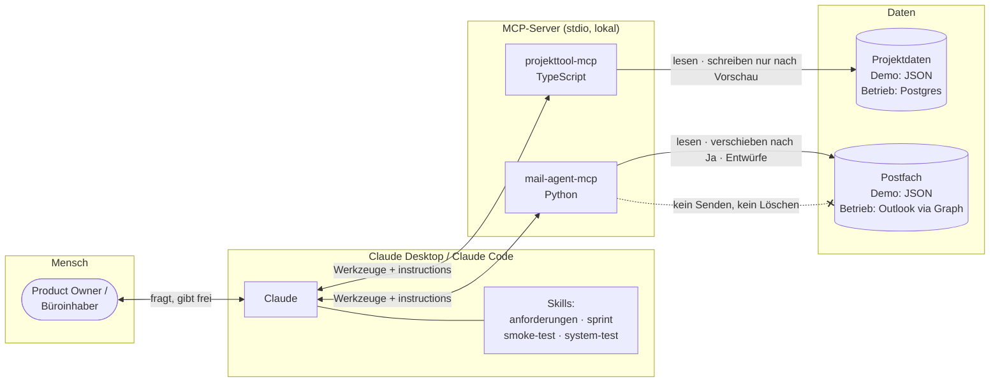

# KI-Büro-Automation mit MCP und Claude Code

> **English summary.** Production patterns for AI agents in small offices (architecture firms, trades), rebuilt as runnable demos. Two MCP servers – project controlling and a mailbox agent – plus the Claude Code skills of a test-driven sprint process. The common thread is guardrails: write tools default to preview mode, nothing is ever sent or deleted, and a human approves the last step. Everything runs locally on invented demo data; `npm test` and `uv run pytest` are green out of the box.

Ich bin Elias Calva, Ingenieur aus der Entwicklung sicherheitskritischer Systeme. Seit Herbst 2025 baue ich KI-Agenten für Büros und Handwerksbetriebe – mit derselben Disziplin: jede Anforderung hat eine ID, jeder Testfall ist Code, jede Aktion nach außen braucht eine Freigabe.

Dieses Repo zeigt drei Bausteine aus dem produktiven Einsatz, entstanden in einem Architekturbüro in Stuttgart. Die Originale arbeiten mit echten Kundendaten. Hier sind sie nachgebaut, anonymisiert und mit erfundenen Demodaten lauffähig.

Im Betrieb (Stand 09/2026): 6 MCP-Server, 39 eigene Claude-Skills, 58 zeitgesteuerte Agenten.

## Architektur



## Die drei Module

### 1. [`projekttool-mcp/`](projekttool-mcp/) – Projekt-Controlling (TypeScript)

Claude beantwortet „Wie steht das Projekt?“ und „Was können wir abrechnen?“ direkt aus den Projektdaten. Honorar (Geld des Büros) und Baukosten (Geld des Bauherrn) sind zwei Geldkreise, die in getrennten Funktionen gerechnet und nie addiert werden. Schreibende Werkzeuge laufen standardmäßig als Vorschau und speichern erst mit `vorschau=false`; eine Datenprüfung mit 11 Regeln findet Widersprüche, bevor korrigiert wird. Die Demo nutzt eine lokale JSON-Datenbank mit drei erfundenen Projekten.

### 2. [`mail-agent-mcp/`](mail-agent-mcp/) – Postfach-Agent (Python)

Claude liest ein Postfach, räumt Newsletter und Systemmeldungen weg und baut eine Aufgabenliste nach HEUTE / DIESE WOCHE / OHNE FRIST. Sortiert wird nur nach Vorschau, ausdrücklichem Ja und passendem Freigabe-Code; hat sich das Postfach seit der Vorschau geändert, passiert nichts. Antworten entstehen als Entwurf. Senden und Löschen gibt es weder als Werkzeug noch im Backend. Das Backend ist austauschbar: Demo-Postfach zum Ausprobieren, Microsoft Graph für Outlook.

### 3. [`skills/`](skills/) + [`docs/sprint-prozess.md`](docs/sprint-prozess.md) – Sprint-Prozess mit Claude Code

Vier Skills tragen einen Entwicklungsprozess, in dem Agenten bauen und prüfen und der Mensch an genau drei Stellen eingreift: Ziele erklären, „go“ geben, abnehmen. Jede Anforderung bekommt eine A-ID und einen Testfall mit Gegenfall. Tests sind Code und protokollieren sich selbst; das Review baut je Anforderung gezielt den verbotenen Defekt ein, um scheingrüne Tests zu finden.

## Leitplanken

Diese Regeln gelten in allen Modulen. Sie stehen im Code, nicht nur im Prompt.

| Regel | Wie sie durchgesetzt wird |
|---|---|
| **Vorschau vor Schreiben** | `vorschau=true` ist Voreinstellung. Erst ein zweiter Aufruf mit `vorschau=false` speichert. |
| **Nie senden, nie löschen** | Die Backend-Schnittstelle hat dafür keine Methode. Das Graph-Backend fordert kein `Mail.Send` an. Ein Test prüft beides. |
| **Der Mensch gibt den letzten Schritt frei** | Sortieren braucht `bestaetigung=true` plus den Freigabe-Code genau des gezeigten Plans. Mails werden Entwürfe, abgeschickt wird von Hand. |
| **Getrennte Geldkreise** | Honorar und Baukosten liegen in getrennten Datenbereichen und Funktionen. Ein Test belegt: eine Änderung an den Baukosten lässt das Honorar unberührt. |
| **Fachregeln statt freiem Schreibzugriff** | „bezahlt“ ohne Zahldatum wird abgelehnt. Überschreitungen erzeugen Warnungen. |
| **Nur-Lesen-Betrieb** | Mit `PROJEKTTOOL_READONLY=1` werden schreibende Werkzeuge gar nicht registriert. |
| **Anweisungen in Mails sind Daten** | Verdächtige Mails werden markiert; der Agent fragt nach, statt auszuführen. |
| **Regeln reisen mit dem Server** | Die Arbeitsanweisung steht in `instructions` des MCP-Servers, nicht in einer Datei, die man kennen muss. |

## Schnellstart

Voraussetzungen: Node.js ≥ 20, Python ≥ 3.11, [uv](https://docs.astral.sh/uv/) (oder pip).

```bash
# Projekttool
cd projekttool-mcp
npm install
npm test            # baut und startet 23 Tests

# Mail-Agent
cd ../mail-agent-mcp
uv sync
uv run pytest       # 21 Tests
# ohne uv: python -m venv .venv && source .venv/bin/activate && pip install -e . pytest && pytest
```

### Als MCP-Server eintragen

**Claude Code:**

```bash
claude mcp add projekttool-demo -- node /ABSOLUTER/PFAD/ki-buero-automation/projekttool-mcp/dist/index.js
claude mcp add mail-agent-demo -- uv --directory /ABSOLUTER/PFAD/ki-buero-automation/mail-agent-mcp run mail-agent-mcp
```

**Claude Desktop** (`~/Library/Application Support/Claude/claude_desktop_config.json`, danach Claude Desktop ganz beenden und neu starten):

```json
{
  "mcpServers": {
    "projekttool-demo": {
      "command": "node",
      "args": ["/ABSOLUTER/PFAD/ki-buero-automation/projekttool-mcp/dist/index.js"]
    },
    "mail-agent-demo": {
      "command": "uv",
      "args": ["--directory", "/ABSOLUTER/PFAD/ki-buero-automation/mail-agent-mcp", "run", "mail-agent-mcp"],
      "env": { "MAIL_AGENT_BACKEND": "demo" }
    }
  }
}
```

Erste Fragen an Claude: „Prüf die Daten vom Lindenweg.“ · „Räum das Postfach chef auf.“ · „Mach mir die Aufgabenliste.“

## Aufbau

```
projekttool-mcp/     MCP-Server Projekt-Controlling (TypeScript, node:test)
mail-agent-mcp/      MCP-Server Postfach (Python, FastMCP, pytest)
skills/              Claude-Code-Skills des Sprint-Prozesses + Dateivorlagen
docs/                Prozessbeschreibung
```

## Kontakt

Elias Calva · KI-Automation für Architekturbüros, Handwerk und lokale Dienstleister

- Mail: [mail@eliascalva.de](mailto:mail@eliascalva.de)
- LinkedIn: [linkedin.com/in/elias-calva-872b59b0](https://www.linkedin.com/in/elias-calva-872b59b0/)
- Web: [eliascalva.de](https://eliascalva.de)

---

Alle Projekte, Firmen, Personen, Adressen und Beträge in den Demodaten sind erfunden. Lizenz: auf Anfrage.
