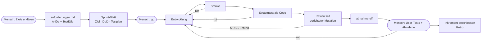

# Sprint-Prozess für KI-gebaute Software

Ein Ein-Personen-Betrieb mit Agenten. Der Mensch ist Product Owner und gibt den letzten
Schritt frei. Agenten übernehmen feste Rollen. **Dateien sind die Schnittstellen** –
kein Agent sieht das Gespräch eines anderen, nichts hängt am Chatverlauf.

## Der Ablauf



Der Mensch greift an genau drei Stellen ein. Alles dazwischen läuft ohne ihn – mit höchstens
zwei Fix-Schleifen, danach meldet der Sprint-Leiter die Lage statt weiterzuprobieren.

## 1. Anforderung mit A-ID und Testfall

Jede Anforderung bekommt eine stabile ID und einen Testfall, bevor gebaut wird.

```
- A-3: Mails werden nur verschoben, nachdem der Mensch genau diesen Plan bestätigt hat.
- TF-5 (A-3) — Sortieren mit und ohne Bestätigung — Erwartung: erfüllt: mit Ja und
  gültigem Freigabe-Code werden 3 Mails verschoben; Gegenfall: ohne Ja bleiben 12 Mails im
  Posteingang — Ebene: system — Ausführung: agent — Code: tests/test_sortieren.py::…
```

Regeln, die aus echten Fehlern entstanden sind:

- **Kein Testfall, keine Anforderung.** Was sich nicht prüfen lässt, ist eine Notiz.
- **Gegenfall-Pflicht.** Sagt die Anforderung *nur*, *nie*, *erst wenn*, muss der Test auch
  die verletzte Seite prüfen. Ein Test, der nur den Erfolgsfall prüft, bleibt grün, auch wenn
  die Bedingung fehlt.
- **Ein Test läuft ohne fremde Voraussetzung.** Hängt eine Anforderung nur an einem Test mit
  API-Key oder Wochentag, ist sie im Sprint nicht nachweisbar.
- **Architektur-Rahmen vor dem ersten Sprint:** Sprache, Speicherort, Verbote, Schnittstellen,
  offene Fragen. Ohne Rahmen kein Testplan.

## 2. Inkrement schneiden

5–8 Anforderungen je Sprint, nie mehr. Zu groß wird geteilt, nie gedehnt. Das Sprint-Blatt
enthält jede Anforderung im vollen Wortlaut, nicht nur die Nummer – der Mensch soll sehen,
was gebaut wird, nicht sich erinnern müssen. Nach dem „go“ ändert sich das Blatt nicht mehr.

## 3. Bauen und prüfen

| Station | Frage | Nachweis |
|---|---|---|
| Entwicklung | Ist es gebaut? | Commit |
| Smoke | Startet es wirklich? | echte Ausgabe, kein „sollte laufen“ |
| Systemtest | Tut es, was die Anforderung sagt? | Testcode, Protokollzeile mit Messwert |
| Review | Prüfen die Tests das Richtige? | gerichtete Mutation je A-ID |

**Test als Code.** Agent-Testfälle werden ausprogrammiert, und der Testlauf schreibt seine
Protokollzeile selbst. Grund: Ein Agent hat einmal Protokollzeilen als geschrieben gemeldet,
die nie geschrieben wurden.

**Gerichtete Mutation.** Der Reviewer leitet je Anforderung das verbotene Verhalten ab, baut
genau diesen Defekt ein und lässt die Tests laufen. Bleiben sie grün, deckt der Test die
Anforderung nicht. Lesen allein findet solche scheingrünen Tests nicht.

**Append-only.** `testprotokoll.md` wird nur ergänzt. Eine gelöschte Zeile ist ein Befund.

## 4. Abnahme durch den Menschen

Der Sprint-Leiter meldet „abnahmereif“ mit einer Anleitung je User-Testfall: was öffnen,
was tun, was erscheinen muss. Dazu ein Befehl, der den geänderten Code und die Tests öffnet,
und einer, der den ganzen Diff zeigt. Der Mensch prüft und meldet zurück.

Eine Anforderung ist erst grün, wenn **alle** Testfälle, die sie decken, zuletzt grün waren.

## Woher die Bausteine kommen

| Herkunft | übernommen | weggelassen |
|---|---|---|
| Scrum | Inkrement, Definition of Done, Retro | Standup, Story Points, Velocity |
| Kanban | WIP-Limit: ein aktiver Sprint je Projekt | Board-Zeremonien |
| Shape Up | fester Rahmen, variabler Umfang | Sechs-Wochen-Zyklen |
| V-Modell | Rückverfolgbarkeit Anforderung → Test → Protokoll | Dokumentenbürokratie |

## Die Skills dazu

[`skills/`](../skills/README.md): `anforderungen`, `sprint`, `smoke-test`, `system-test`.
